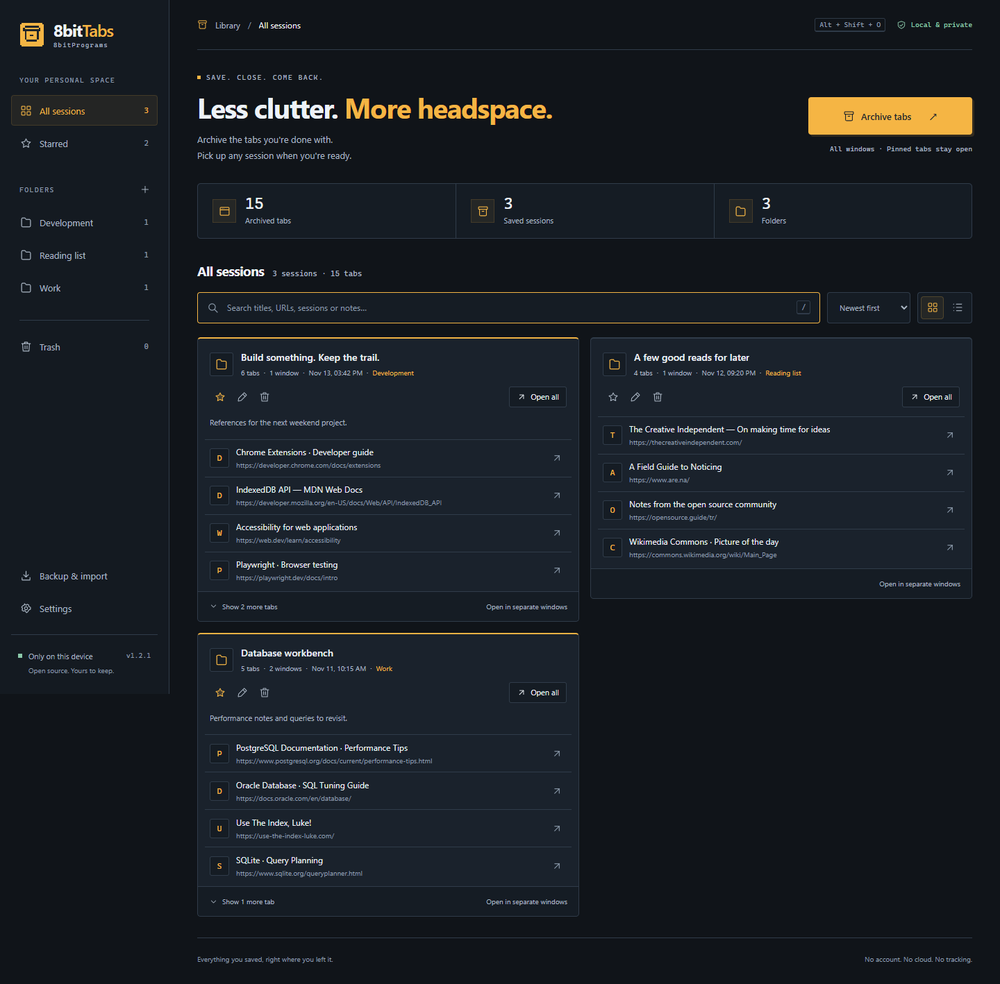

# 8bitTabs

**Less clutter. More headspace.**

A local, open-source tab archive for Chromium browsers. One click saves your tabs into a dated session, verifies the saved copy, and closes the archived tabs. **Pinned tabs stay open by default.**

Part of the 8bitPrograms Pixel Core family: a stepped pixel archive box, charcoal surfaces, and amber accents. Version **1.2.1**.

[Türkçe rehber](README.tr.md) · [Privacy](PRIVACY.md) · [Verification](docs/TEST-REPORT.md)



The sessions in the screenshot are examples. A new installation starts with an empty archive.

## Install locally

1. Open `chrome://extensions`, `brave://extensions`, or `edge://extensions`.
2. Turn on **Developer mode**.
3. Choose **Load unpacked** and select the project's **`extension`** directory.
4. Pin 8bitTabs to your browser toolbar.

Download the install ZIP from [GitHub Releases](https://github.com/8bitPrograms/8bitTabs/releases/latest). If using `8bitTabs-1.2.1-chromium.zip`, extract it to a permanent directory first, then select the directory containing `manifest.json`. The source ZIP also includes tests and documentation; load its `extension` subdirectory.

You do not need Node.js, a build step, an account, or a server to run the extension. Chrome Web Store publication is pending. [Source and support](https://github.com/8bitPrograms/8bitTabs) · [Report an issue](https://github.com/8bitPrograms/8bitTabs/issues).

## Use your archive

- **Archive:** click the toolbar icon or **Archive tabs** on the archive page. All normal windows are included by default. Settings can limit the action to the current window and include pinned tabs.
- **Browse without closing anything:** press **Alt+Shift+O**, or right-click the extension icon and choose **Options**. The archive page opens automatically on first installation.
- **Find:** search titles, URLs, session names, notes, and folder names. Search is limited to the selected view or folder. Accents and Turkish dotted/dotless I are folded; German `ß` also matches `ss`.
- **Organize:** rename sessions, add notes, star favorites, and move sessions into folders. Choose cards or a list; the view is remembered.
- **Restore:** open one link, a whole session in the current window, or the original window partitions. The saved copy stays in your archive. Large restores ask for confirmation.
- **Delete:** move sessions to Trash and recover them later. Permanent deletion asks for confirmation. There is no automatic deletion or retention timer.
- **Move your data:** export JSON, merge a JSON backup, or import OneTab's `URL | Title` text format. Blank lines separate OneTab sessions.

The three totals show all active archived records and folders. Filtering your view does not change those totals. The app does not estimate memory savings or invent browser-performance statistics.

## Language and appearance

**English is the explicit default**, even if the browser uses another language. Choose **Settings → Language**, select **English, Türkçe, Deutsch, Français, or Español**, and save.

Messages, labels, dates, counters, tooltips, and the toolbar description use your choice. It is saved on this device and synchronized across open archive pages. Session and folder names, page titles, notes, and URLs are user content and are never translated or rewritten.

Dark, light, and system themes are available. The app UI language is independent of the browser's language. Native `_locales` files provide store metadata in the same five languages.

## What gets saved

The archive stores URLs, titles, session timestamps, tab/window order, pin state, mute state, names, folders, stars, and notes. It does **not** capture page content, form values, scroll position, back/forward history, authentication sessions, or browser tab groups. Save unfinished work before archiving its tab.

Private windows are disabled. Supported URLs include HTTP, HTTPS, file URLs, `about:blank`, and a small allowlist of ordinary Chromium pages. Other extensions, developer tools, executable/temporary URLs, and browser crash/restart pages are skipped. Browser policies may prevent reopening some file or internal URLs.

## Save before close

The session is written in a single IndexedDB transaction with a strict durability preference. The transaction must complete, and the saved record must read back unchanged. The archive page must be reachable before closing begins.

Before each close, the extension checks the tab's URL, window, and pin state again. A tab that changed during saving stays open. One failed close does not delete its archived copy or prevent other tabs being processed. Rapid toolbar clicks share the in-progress archive operation. A later browser startup never resumes an old closing job.

These checks reduce accidental data loss; they do not replace backups or prove recovery from power loss or physical disk failure.

## Privacy and permissions

There are no runtime dependencies, content scripts, remote code, accounts, analytics, advertisements, cloud synchronization, or external favicon requests. The extension's CSP blocks its own network connections with `connect-src 'none'`. Pages you choose to reopen make their usual network requests.

| Permission | Why it is used |
| --- | --- |
| `tabs` | Read open tabs' URLs, titles, and metadata for the archive operation. The browser may describe this broadly as history access; 8bitTabs does not read the browsing-history database. |
| `unlimitedStorage` | Avoid normal local-storage quota and eviction limits as the archive grows. Physical storage is still finite. |

Local data and downloaded backups are **not encrypted by 8bitTabs**. URLs may contain sensitive query parameters. Make and keep a JSON backup before uninstalling the extension, removing its browser profile, or moving to a different extension installation. See [PRIVACY.md](PRIVACY.md) and [PRIVACY.tr.md](PRIVACY.tr.md).

## Backups and pre-rebrand data

The current JSON format is `8bittabs-backup`, version 1. Older development builds used `tabdock-backup`; those files remain importable. The internal database name is intentionally retained so an update at the same extension origin keeps the existing archive.

Imports are validated completely, then merged atomically. Existing sessions with the same ID are kept rather than overwritten, including their local edits and Trash state. Same-named folders are merged. JSON exports include Trash and folders, but exclude settings. OneTab text has no persistent session IDs, so importing the same text again creates new sessions.

Imports accept up to **25 MB** and **100,000 tabs per file**. Local archives can grow beyond that size; a larger JSON export is outside the supported single-file import limit. Do not rely on an oversized export as a tested restore path.

When updating an unpacked installation, keep the same installation directory and click **Reload** on the extensions page. Moving the directory can change the unpacked extension's identity. Export before switching folders or moving to a store-installed copy, then import the backup into the new installation.

## Develop and verify

Node.js 22+ is recommended for maintainer tools. The core tests need no external packages:

```sh
node --test tests/*.test.js
```

For browser tests and asset generation:

```sh
npm install
npx playwright install chromium
npm run icons
npm run test:browser
npm run store
npm run submission
npm run package
```

`TABDOCK_BROWSER` can point the test runner at a compatible Chromium or Brave executable. `TABDOCK_NODE_MODULES` can point maintainer tools at an existing development dependency directory. Those legacy environment variable names are not part of the extension runtime.

Browser checks run against local HTTP fixtures and an isolated profile under `test-results/`. They do not attach to the personal browser profile. Reports and screenshots remain there for inspection; test profiles and test data are excluded from release ZIPs.

`npm run icons` renders the source SVG into Pixel Core icons, including a padded 128 px store icon. `npm run store` prepares three actual 1280×800 browser screenshots and promotional artwork as RGB PNGs. Run browser tests first. `npm run submission` prepares the store field guide and copyable text. `npm run package` creates deterministic install/source/store-assets ZIPs and SHA-256 checksums without any third-party packaging dependency.

```text
extension/          Readable MV3 runtime; no build step
  _locales/         Native Chrome store metadata
  locales/          Five complete app UI catalogs
  core.js           URL policy, search and backup validation
  database.js       Atomic local persistence
  service.js        Save, close, restore and organization
  background.js     Browser events and serialized mutations
  manager.*         Archive markup and UI behavior
  workspace.css     Pixel Core design system and layouts
assets/            Source SVG and exported brand image
tests/             Behavior, failure and localization checks
scripts/           Browser checks, asset generation and packaging
store/             Listing drafts, icon, screenshots and promo artwork
```

The complete test scope and its limits are in [docs/TEST-REPORT.md](docs/TEST-REPORT.md). Prepared listing fields and upload files are explained in [store/submission/README.tr.md](store/submission/README.tr.md). Store publication still requires the publisher's account declarations and the store's review.

## License

[GNU General Public License v3.0](LICENSE). You can inspect, modify, and redistribute the source under the license terms.
