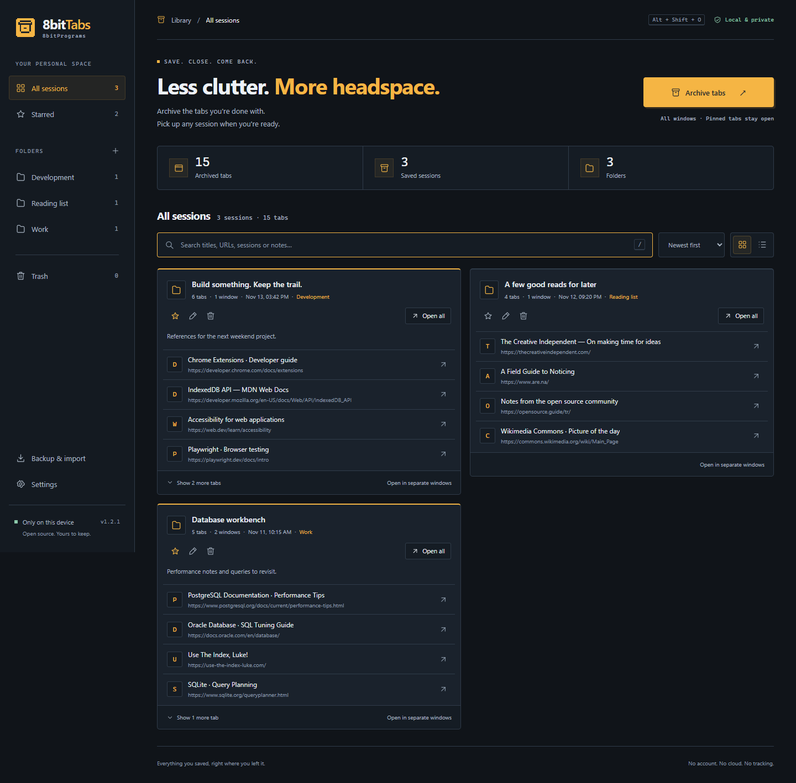

# 8bitTabs

**Sekmeler kapansın. Fikirler kalsın.**

OneTab benzeri, tamamen yerel çalışan, GPL-3.0 lisanslı bir Chromium sekme arşivi. Beş dilli arayüz; tarayıcıya yüklenen dosyaların tamamı okunabilir kaynak kodudur. Derleme, hesap veya sunucu gerektirmez. Güncel sürüm: **1.2.1**.

[English](README.md) · [Gizlilik](PRIVACY.tr.md)

8bitTabs, önceki geliştirme sürümünün yeni adıdır. 8bitPrograms Pixel Core ailesine uygun piksel arşiv kutusu simgesi, grafit yüzeyler ve amber vurgularla yeniden tasarlandı. Kart ve liste görünümü arasında geçiş yapılabilir; tercih saklanır. Üstteki sekme, oturum ve klasör sayıları tüm etkin arşive aittir; arama yapmak bu toplamları değiştirmez.



Ekran görüntüsündeki oturumlar örnektir; kurulum boş bir arşivle başlar.

## Kurulum

1. Chrome'da `chrome://extensions`, Brave'de `brave://extensions`, Edge'de `edge://extensions` sayfasını aç.
2. **Geliştirici modu**nu aç.
3. **Paketlenmemiş öğe yükle / Load unpacked** düğmesine bas.
4. Bu projenin **`extension`** klasörünü seç. `manifest.json` doğrudan bu klasörde olmalı.
5. Eklentiler menüsünden 8bitTabs simgesini araç çubuğuna sabitle.

ZIP paketini kullanıyorsan önce kalıcı bir klasöre çıkar; sonra `manifest.json` içeren klasörü seç. Paketlenmemiş eklentinin klasörünü sonradan taşıma veya silme. Ayrıntılar: [KURULUM.md](KURULUM.md).

Güncel ZIP: [GitHub Releases](https://github.com/8bitPrograms/8bitTabs/releases/latest). Destek: [GitHub Issues](https://github.com/8bitPrograms/8bitTabs/issues). Chrome Web Store yayını inceleme süreci tamamlandıktan sonra eklenecek.

## Dil seçimi

**Varsayılan dil İngilizcedir**, tarayıcının veya işletim sisteminin dili ne olursa olsun. **Settings → Language** bölümünden **English, Türkçe, Deutsch, Français veya Español** seçip **Save settings** düğmesine bas. Türkçe arayüzde aynı yol **Ayarlar → Dil** şeklindedir.

Tercih cihazda saklanır; açık arşiv sayfalarına uygulanır ve tarayıcı yeniden başlatıldığında korunur. Menüler, ipuçları, hata ve bildirim mesajları, sayaçlar, tarihler ve araç çubuğu açıklaması seçilen dili kullanır. Yeni tarihli oturum adları ve OneTab aktarım başlıkları da seçilen dilde oluşturulur. Mevcut oturum adları, klasör adları, sayfa başlıkları, notlar ve adresler kullanıcı verisidir; dil değişiminde yeniden yazılmaz.

1.0.0 sürümünden gelen ayarlara İngilizce dil varsayılanı eklenir; sabitlenmiş sekme, kapsam ve tema tercihleri korunur. Yedek biçimi değişmemiştir. Dil tercihi diğer ayarlar gibi JSON yedeğine dahil edilmez.

1.2.0 ile dışa aktarılan yedeklerin biçim adı `8bittabs-backup` oldu; sürüm numarası hâlâ 1. Önceki `tabdock-backup` dosyaları içe alınabilir. Var olan oturum adları ve notlar korunur. Yerel kurulum dizinini değiştirmeden güncellemek mevcut eklenti kimliğini ve arşivini korur. Yeni dizine veya mağaza kurulumuna geçmeden önce yedek alıp yeni kurulumda içe aktar.

## Nasıl çalışır?

**Araç çubuğundaki simgeye bir kez tıklamak**, tüm normal pencerelerdeki uygun sekmeleri tarihli bir oturuma kaydeder ve kapatır. Sabitlenmiş sekmeler varsayılan olarak açık kalır. Arşiv sayfası kendisini arşivlemez.

Arşiv ekranında:

- Başlık, URL, oturum adı, not ve klasör adıyla ara. Türkçe harfler ve aksansız arama desteklenir.
- Oturumları yeniden adlandır, not ekle, yıldızla ve klasörlere taşı.
- Bir bağlantıyı, tüm oturumu veya oturumu özgün pencere ayrımına göre aç.
- Açılan bağlantılar arşivde kalır; geri açmak kayıtları tüketmez.
- Sildiğin oturumları çöp kutusundan geri al. Kalıcı silme ayrıca onay ister; otomatik silme yoktur.
- JSON yedeği indir veya içe aktar. OneTab'ın `URL | Başlık` biçimindeki metin dışa aktarımını al; boş satırlar ayrı oturum olur.
- Koyu, açık veya sistem temasını seç; kart/liste görünümü tercihi de kaydedilir.
- Arayüz dilini ayarlardan değiştir; aksansız arama her arayüz dilinde çalışır.

**Arşivi sekme kapatmadan açmak için** `Alt+Shift+O` kullan veya simgeye sağ tıklayıp **Seçenekler**'i aç. İlk kurulumda arşiv kendiliğinden açılır. Kısayol tarayıcıda başka bir eklentiyle çakışırsa eklentilerin klavye kısayolları sayfasından değiştirilebilir.

**Ayarlar** bölümünde sabitlenmiş sekmeleri de dahil edebilir ve kapsamı yalnızca bulunduğun pencereye indirebilirsin. Eklenti sayfasındaki arşivle düğmesi için “bu pencere”, arşiv sayfasının bulunduğu penceredir.

## Kayıt güvenliği

Oturum, IndexedDB'ye `strict` dayanıklılık tercihiyle tek işlemde yazılır. Yazma işleminin tamamlanması beklenir ve kayıt geri okunarak doğrulanır. Arşiv sayfası açıldıktan sonra kaynak sekmeler kapatılır. Kaydetme veya doğrulama başarısızsa hiçbir sekme kapatılmaz.

Kapatmadan hemen önce sekmenin adresi, pencere kimliği ve sabitlenme durumu tekrar kontrol edilir. Bu sırada değişen sekmeler açık bırakılır. Bir sekmenin kapatılamaması arşivdeki kaydı etkilemez. Çok hızlı tekrarlanan araç çubuğu tıklamaları aynı devam eden işleme katılır. Tarayıcı işlem sırasında kapanırsa kaydedilmiş oturum korunur; sonraki başlangıçta eski sekmeleri kapatmaya devam edilmez.

Arşiv, **URL, başlık, pencere sırası, sekme sırası, sabitlenme ve sessize alma durumu** içerir. Sayfaların birer kopyası değildir: form verileri, sayfa içeriği, geri/ileri geçmişi, giriş oturumları, kaydırma konumu ve tarayıcının sekme grupları kaydedilmez. Form verisi olan sekmeleri arşivlemeden önce çalışmanı kaydet.

## Gizlilik ve izinler

Çalışan eklentide üçüncü taraf bağımlılık, uzak kod, analiz servisi, reklam, bulut senkronizasyonu, içerik betiği veya harici favicon isteği yoktur. Simgeler yerel dosyalardan, site harfleri URL'den üretilir. `connect-src 'none'` ilkesi eklenti sayfaları ve arka plan işlemcisinin ağ bağlantılarını engeller. Geri açmayı seçtiğin web sayfaları normal şekilde kendi sunucularına bağlanır.

| İzin | Gerekçesi |
| --- | --- |
| `tabs` | Açık sekmelerin başlıklarını ve URL'lerini okuyup arşivlemek. Tarayıcı bunu geniş bir geçmiş uyarısıyla gösterebilir; eklenti geçmiş veritabanını okumaz. |
| `unlimitedStorage` | Yerel arşivin normal depolama kotası veya otomatik tahliyeyle kaybolma riskini azaltmak. Fiziksel disk alanı yine sınırlıdır. |

Gizli pencerelerde çalışma kapalıdır. `http`, `https`, `file`, `about:blank` ve sınırlı sayıdaki güvenli Chromium iç sayfası desteklenir. Diğer eklentilerin sayfaları, geliştirici araçları, `javascript:`, `data:`, `blob:` ve tarayıcının çökertme/yeniden başlatma sayfaları açık bırakılır. Dosya ve iç sayfaların geri açılması tarayıcı politikalarıyla engellenebilir.

Veriler ve yedekler uygulama tarafından şifrelenmez. Eklentiyi kaldırmak veya tarayıcı profilini silmek yerel arşivi silebilir. **Kaldırmadan önce JSON yedeği al.** Ayrıntılar: [PRIVACY.tr.md](PRIVACY.tr.md).

## Yedekleme ve aktarım

JSON dışa aktarımı tüm oturumları, çöp kutusunu ve klasörleri kapsar; ayarları kapsamaz. İçe aktarım mevcut verinin üzerine yazmaz. Aynı oturum kimliği tekrar gelirse yerel kayıt korunur ve gelen kayıt atlanır. Bu nedenle bir yedeği geri almak, aynı kimlikteki mevcut bir oturumun içeriğini eski sürümüne döndürmez. Aynı adlı klasörler birleştirilir. OneTab metni kimlik taşımadığından aynı metni tekrar almak yeni oturumlar ekler.

Dosya boyutu en fazla **25 MB**, dosya başına toplam **100.000 sekme**dir. Dosyanın tamamı doğrulanmadan hiçbir kayıt yazılmaz; aktarım tek veritabanı işleminde uygulanır. Yedek dosyalarındaki adresler kişisel veya gizli bağlantılar içerebilir.

## Geliştirme

Eklentiyi kullanmak için Node.js veya paket kurulumu gerekmez. Testler ve simge üretimi için Node.js 22+ önerilir.

```sh
npm install
npm test
npx playwright install chromium
npm run test:browser
npm run store
npm run package
```

Temel testler harici paket kullanmaz ve doğrudan `node --test tests/*.test.js` ile de çalışır. Tarayıcı testleri yerel HTTP sayfaları ve ayrı, geçici bir profil kullanır. Kişisel tarayıcı profiline veya sekmelere bağlanmaz. `test-results/` altında test profilleri, rapor ve ekran görüntüleri bırakır.

Uyumlu bir Chromium/Brave yürütülebilir dosyasını kullanmak için `TABDOCK_BROWSER` ortam değişkenini ver. Hazır bir geliştirme bağımlılık klasörü varsa `TABDOCK_NODE_MODULES` kullanılabilir. Bunlar yalnızca geliştirme araçlarınca okunur; eklentide ortam değişkeni veya sistem erişimi yoktur.

`npm run icons`, [assets/logo.svg](assets/logo.svg) dosyasından yerel PNG simgelerini üretir. `npm run package` harici bağımlılık olmadan, sabit dosya sırasıyla tekrarlanabilir ZIP'ler ve SHA-256 özetleri üretir. Test profilleri ve yedek verileri dağıtım paketlerine girmez.

```text
extension/
  manifest.json     MV3; iki izin; uzak bağlantılar kapalı
  core.js           URL politikası, arama, aktarım doğrulaması
  database.js       IndexedDB; atomik işlemler
  service.js        Kaydetme, kapatma, geri açma ve düzenleme
  background.js     Tarayıcı olayları; işlemlerin sıraya alınması
  i18n.js           Yerel dil seçimi, sayılar, çoğullar ve mesajlar
  locales/          English, Türkçe, Deutsch, Français, Español çevirileri
  manager.*         Yerel arşiv arayüzü
  workspace.css     Pixel Core tasarımı ve görünüm düzenleri
  icons/            Paketle birlikte gelen PNG simgeleri
tests/              Birim ve hata senaryoları; ekran görüntüsü örnekleri
scripts/            Paketleme, simge üretimi ve tarayıcı kontrolleri
```

Kontrol kapsamı ve sınırları: [docs/TEST-REPORT.md](docs/TEST-REPORT.md).

Teknik dayanaklar: [Chrome Tabs API](https://developer.chrome.com/docs/extensions/reference/api/tabs), [Chrome Action API](https://developer.chrome.com/docs/extensions/reference/api/action), [Chrome depolama davranışı](https://developer.chrome.com/docs/extensions/develop/concepts/storage-and-cookies), [Playwright eklenti testleri](https://playwright.dev/docs/chrome-extensions).

## Lisans

[GNU Genel Kamu Lisansı v3.0](LICENSE). Kaynak kodu lisansın koşullarıyla inceleyebilir, değiştirebilir ve yeniden dağıtabilirsin.
